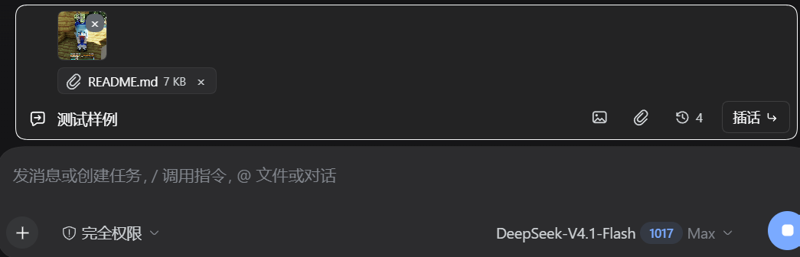

# 插话引导（dsh-steer-note）

> A compact mid-turn steering box for DeepSeek Harness: text, images, and files, read receipts, and unfinished-draft rescue when a turn ends.

> **AI 声明**：本插件主要由 AI（DeepSeek Harness 中的 deepseek-flash）编写，维护者负责需求、审查和真机测试。
>
> **AI disclosure**: Primarily written by an AI assistant (deepseek-flash in DeepSeek Harness); the maintainer directed, reviewed, and tested it.

> **npm 状态**：尚未发布到 npm。请先用 GitHub 安装：
> `dsh plugin --profile web add github:hffek/dsh-steer-note`
>
> **npm status**: Not published to npm yet; install from GitHub for now.

在对话输入框上方增加一条插话栏：任务运行时可以随时补充方向，不用把内容塞进主输入框，也不会覆盖主输入框里的草稿，更不会挡住输入框下方的 token 用量和缓存命中显示。



## 安装

### npm（尚未发布）

npm 包还没有发布；现在请用下面的 GitHub 方式安装。

### GitHub

从 GitHub 安装：

```bash
dsh plugin --profile web add github:hffek/dsh-steer-note
```

### 本地开发目录

本地开发目录安装：

```bash
dsh plugin --profile web add link:/absolute/path/to/dsh-steer-note
```

Desktop 请把 `--profile web` 换成 `--profile desktop`。安装后重启 DSH；Host 半侧的 `STEER_NOTE` 系统提示词需要重启才会生效。

## 用法

- 当前会话的 Agent 正在运行，或这个会话里还有未发送的插话草稿时，插话栏会出现。
- `Enter` 发送，`Shift+Enter` 换行，`Esc` 让输入框失焦。
- 文字、图片和普通文件可以一起发送：图片按钮只选图片，回形针按钮可选任意文件，也可以直接粘贴 / 拖入。发送时附件排在文字前面，和原生 composer 的顺序一致。
- 图片支持 PNG、JPEG、WebP、GIF；张数、单张大小、总大小和边长限制读取原生 `imageLimits` 投影。图片需要当前模型支持视觉输入，否则会返回“当前模型不支持图片输入”。
- 普通文件通过原生 `conversation.createDrafts` 注册并后台上传，发送时用上传回执 `{ type: 'file', receiptId }` 进入 prompt；上传中会显示进度，失败会显示原因。
- 发送使用与原生输入框相同的 `session.prompt({ mode: 'steer' })` 通道，消息会作为正常的“插话”进入会话，并在下一步生效。
- **任务结束时如果插话还没发送，草稿会自动搬到主输入框**：文字追加到现有草稿（空草稿则直接填入），图片用 `conversation.createDrafts` 转成原生草稿附件，已有的文件草稿直接把 attachment id 交给主输入框。主输入框正在发送或暂时不可用时，草稿留在插话栏，并显示“放入输入框”重试按钮。
- 搬运成功后释放图片预览 URL；搬运失败时保留草稿和附件。
- **插话草稿按会话持久化**：文字写入浏览器 localStorage，切换会话或刷新页面后会恢复；图片也会尽量保存（受 localStorage 容量限制，太大时会提示切换后不保留）。普通文件附件只保存在当前页面内存里，切换会话仍保留，但刷新页面会丢失。空闲会话里如果还有草稿，插话栏仍会显示，并提供“放入输入框”。
- **插话记录/读取状态**：每发送一条插话，历史按钮会记录它，并显示 `已读取`、`待读取`、`已送达`、`未读取` 或 `已取消`。已读取来自 Chat 的 `steering` 节点，待读取来自 `inbox.next-step` / `next-turn`；回合结束仍没读到就标为未读取。点历史条目可把文字回填到插话栏（图片和文件不会回填，需要重新添加）。
- **取消插话**：还在 inbox 里、尚未被读取的插话，历史条目右侧会显示“取消”；点了会调用原生 `updateQueue({ action: { kind: 'remove' } })`。已经读取或已经失效的插话会提示无法取消。
- 插话记录和文字/图片草稿只保存在本机浏览器 localStorage；文件草稿只在当前页面内存，并通过原生上传服务上传。它们只包含本插件发出的插话，不包含主输入框的历史消息。
- **自定义 steer 语义**：Host 半侧注册一个 `STEER_NOTE` 系统提示词小节，告诉模型“中途到达的用户消息是当前任务的航向修正，不要当成新任务/不要重开任务”。消息本身仍然走原生 `session.prompt`，所以 UI、日志、图片附件和读取状态都保持原生行为。
- 系统提示词小节是 Host 半侧改动，**需要重启 DSH 才会生效**；Client 半侧的 UI 改动可以通过重载插件生效。
- one-shot 子代理会话不显示插话栏。

## 兼容性

测试环境：DSH Desktop `2.0.18` / DSH `0.2.1-rc.2`（Web profile）。

依赖的客户端插槽接口：

- `conversation.input.dock` slot
- `useSessionStatus`、`useSession`、`useProjection`、`useInput`、`useChat`、`inputActions`

依赖的原生 Remote：

- `ctx.remote.session.prompt({ mode: 'steer' })`
- `ctx.remote.session.updateQueue({ action: { kind: 'remove' } })`（取消未读取插话）

依赖的客户端内部服务（通过 `ctx.get('conversation')`）：

- `createDrafts` / `releaseDraftAttachment(s)`：注册和释放草稿附件
- `fileUploads.getSnapshot()`：普通文件的后台上传状态
- `serializeDraftAttachments`：把已完成的文件上传转成 `{ type: 'file', receiptId }`

降级行为：

- 如果 `updateQueue` 不可用，不显示取消按钮。
- 如果 `createDrafts` / `addAttachments` / `serializeDraftAttachments` 不可用，文字仍会搬到主输入框；图片/文件保留在插话栏并提示手动添加。
- 如果 `fileUploads` 不可用，普通文件不能发送或显示进度；图片和文字不受影响。
- 如果 `useChat` 暂时返回空节点或 inbox 投影不可用，历史状态会停留在“已送达”，不会误报“已读取”。
- 历史/文字/图片草稿保存在本机 localStorage；普通文件草稿只在当前页面内存，刷新会丢失。

注意：文件附件和图片搬家用到客户端内部服务，不是公开文档 API；DSH 升级后需要回归测试。文本/图片/文件发送、历史、取消都走原生公开接口。

## 文件

- `client.js`：渲染插话栏、图片/文件预览和插话记录，注册 `conversation.input.dock` slot（输入框上方的全宽区域，排在 todo / goal / queue 之后、最靠近输入框的位置），并通过 `ctx.remote.session.prompt` 提交文字、image content part 和 `{ type: 'file', receiptId }`；普通文件用 `ctx.get('conversation').createDrafts` 注册并后台上传，发送前用 `serializeDraftAttachments` 换成回执；任务结束时用 `inputActions.setDraft` / `inputActions.addAttachments` 把草稿和附件搬到主输入框；历史/读取状态来自 slot 的 `useChat`（`legacy.nodes` 里的 `steering`/`user` source.rpcId）和 `useProjection('inbox')`。客户端插件需在 `inject` 中声明 `remote` 和 `remote.session`，否则 Cordis 会拒绝读取 `remote.session`。
- `index.js`：Host 半侧，注册 `STEER_NOTE` 系统提示词小节（`ctx.systemPrompt.section`），定义“中途消息是航向修正”的模型语义；不提供自定义 Host RPC、不改变消息 source。
- `cordis.patch.yml`：向当前 profile 插入插件行。
- `locale/*.json`：插件管理器显示用的标题和描述。

## 注意

`package.json` 的 `exports` 必须保留 `"./package.json": "./package.json"`。Desktop 的 client-modules 在 `loader.internal` 不可用时通过 `require.resolve('<包名>/package.json')` 定位清单；缺少这个导出会让该包被缓存为“非客户端插件”，直到重启。
